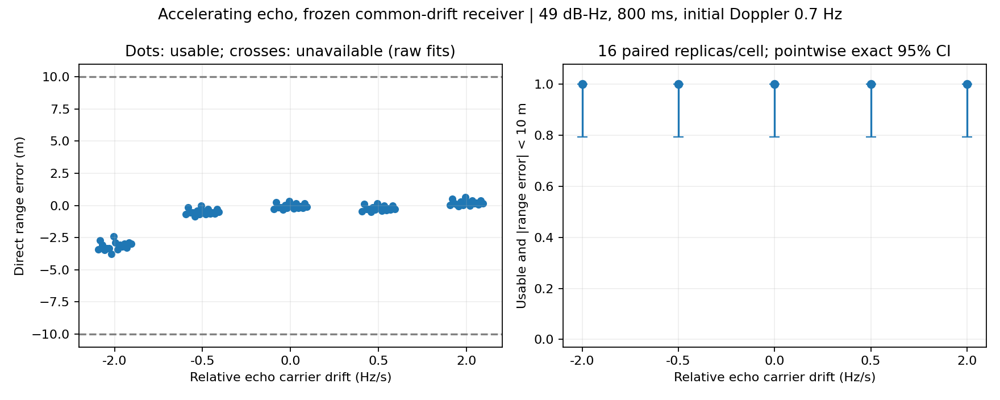

# 加速度を持つ反射経路：固定受信器の感度実験

前段の[等速反射実験](cpu_moving_echo_pilot.md)に続き、反射の余剰経路長を
`L(t) = L0 + v0*t + a*t²/2` とした。相対搬送波 Doppler は
`-fL1*(v0+a*t)/c`、コード遅延は `L(t)/c` であり、同一の経路長から両方を生成する。
直接波の遅延は固定し、共通周波数・ドリフトは発振器の外乱として扱う。

## 実装と事前固定条件

- `python/gnss_gpu/accelerating_echo_cpu.py`：周波数成分ごとの実効周波数
  `common-(fL1+f)*v0/c` と実効ドリフト `common_drift-(fL1+f)*a/c` を20msごとに
  24点Gauss–Legendre積分する。512成分ずつ処理し一時メモリを制限する。
- 加速度ゼロは既存の等速生成器に委譲し、観測値がビット単位で一致する。
- 余剰経路長の正値条件は両端だけでなく、区間内の二次関数の頂点も検査する。
- 初期相対Doppler 0.7Hz。相対搬送波ドリフト 0, ±0.5, ±2Hz/s。
  これは余剰経路の加速度 0, ∓0.09515, ∓0.38059m/s²に対応する。
- PRN1、800ms、片側帯域7.3656MHz、直接波C/N0 49dB-Hz（単位利得フィルタ前）、
  反射電圧比0.8、初期余剰遅延0.03chip、初期相対位相π。
- 新規ID 1350000–1350015の16組を全5条件で共有する。雑音、直接波初期遅延・位相、
  発振器の周波数・ドリフトを対応させる。計80観測だが独立な80組ではない。
- 生成前に条件・タスク・継承したソースのSHA-256を保存する。

受信器は既存の `bandwidth_drift_paths_cpu` を変更せず、固定コード遅延・両経路共通の
ドリフトを仮定する。2経路が存在すると既知の条件で、従来の局所適合判定に合格し、
直接波距離誤差が10m未満なら成功とする。モデル次数を選ぶ校正ゲートは使わない。
各条件の区間は点ごとのClopper–Pearson 95%区間。探索実験であり有意差検定は行わない。

## 結果

| 相対Doppler変化 (Hz/s) | 成功 | 絶対距離誤差中央値 (m) | 最大絶対誤差 (m) |
|---:|---:|---:|---:|
| 0 | 16/16 | 0.166 | 0.343 |
| −0.5 | 16/16 | 0.534 | 0.861 |
| +0.5 | 16/16 | 0.276 | 0.495 |
| −2 | 16/16 | 3.144 | 3.770 |
| +2 | 16/16 | 0.167 | 0.631 |

全条件で局所判定の不合格・10m以上の誤差はゼロだった。しかし−2Hz/s条件では
加速度ゼロより誤差中央値が大きく、粗い成功率だけではモデル不一致による劣化を
捉えられない。各16/16の成功率95%区間は79.4–100%であり、一般的な頑健性の証明ではない。

正負の非対称性にも注意が必要である。初期相対Dopplerを+0.7Hzに固定したため、
−2Hz/s条件は観測中にゼロを横切り、終了時−0.9Hzになる。一方+2Hz/s条件は
終了時+2.3Hzとなる。加速度の符号だけの一般的な効果とは解釈できない。
原因の切り分けには、初期Dopplerも反転した対応比較が必要である。



結果：`output/cpu-accelerating-echo-pilot/{protocol.json,evaluation.jsonl,report.json}`。
単体・回帰テスト9件が通過。監査結果は同ディレクトリの`audit.json`に保存する。

## 再現と検証

```bash
source /workspace/.gnss-env/activate.sh
pytest -q tests/test_accelerating_echo_cpu.py tests/test_moving_echo_cpu.py tests/test_bandwidth_drift_paths.py
# 空の出力先が必要。完了済みの結果は上書きしない。
python -m experiments.run_cpu_accelerating_echo_pilot
python -m experiments.audit_cpu_accelerating_echo_pilot
python -m experiments.plot_cpu_accelerating_echo_pilot
```

独立な50,000点の時間積分で正負両方の加速度を検証する。監査では全観測のハッシュ・
雑音対応・距離誤差・正値条件と、各条件1件の受信処理全体の再実行を確認する。

## 適用範囲

合成された調波観測であり、RF波形のリサンプリングや周波数ビン間の漏れは含まない。
反射振幅は一定で、実際の木・葉の運動、遮蔽、降雨、多衛星PVTは未実装である。
余剰経路の加速度は反射物体そのものの加速度とは限らず、幾何から導く必要がある。
今回の結果だけで現実の森林での測位精度や研究上の新規性を主張することはできない。
