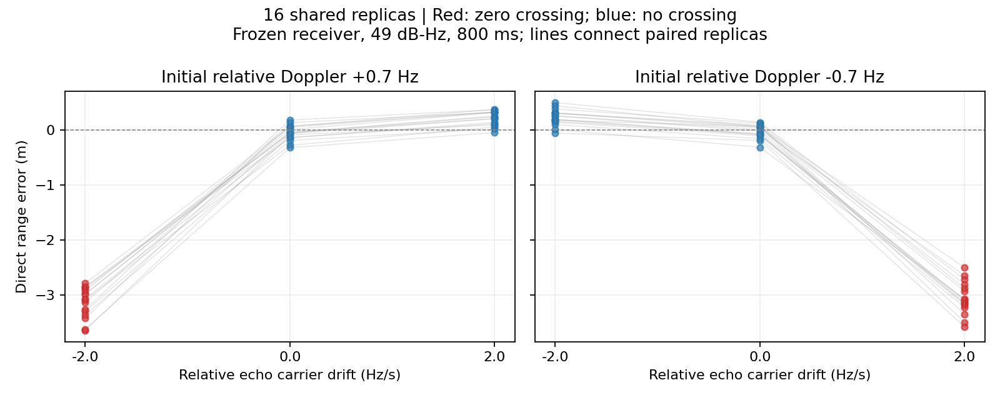

# 初期Dopplerと反射加速度の符号反転

[前回](cpu_accelerating_echo_pilot.md)は初期相対Doppler +0.7Hz、相対ドリフト−2Hz/sで
距離誤差が増えた。今回は初期相対Dopplerを±0.7Hz、相対ドリフトを0, ±2Hz/sにして、
特定の符号に限った現象かを調べる。コード遅延と搬送波位相を同一の二次経路長から生成する。
受信器は既存の固定コード遅延・両経路共通ドリフトのモデルを変更しない。

## 事前に固定した条件

6条件×新規16組（ID 1370000–1370015）。全条件で同じ雑音・直接波初期遅延/位相・
発振器の周波数とドリフトを対応させる。前回の16組とは独立で、結果は合算しない。
49dB-Hz（単位利得フィルタ前）、800ms、片側帯域7.3656MHz、PRN1、反射電圧比0.8、
初期余剰遅延0.03chip、相対位相π。経路長は全観測区間で正であることを確認する。

成功は2経路の存在が既知の条件で「局所適合判定に合格し直接波距離誤差10m未満」。
モデル選択ゲートは使わない。成功率だけでなく、符号付き距離誤差・絶対誤差と、
同じ初期Dopplerの加速度ゼロ条件からの対応差も記録する。
探索実験であり有意差検定は行わない。成功率の95%区間は点ごとのClopper–Pearson区間。

初期Dopplerとドリフトが逆符号の条件では0.35秒でゼロを横切る。同符号の条件では
ゼロを横切らない。ただし、符号反転は積分位相や相対Dopplerの時間履歴も変えるため、
ゼロ交差だけの因果効果を同定する設計ではない。

## 結果

| 初期Doppler (Hz) | 相対ドリフト (Hz/s) | ゼロ交差 | 絶対誤差中央値 (m) | 符号付き誤差中央値 (m) | 成功 |
|---:|---:|:---:|---:|---:|---:|
| +0.7 | +0.0 | なし | 0.081 | -0.047 | 16/16 |
| +0.7 | -2.0 | あり | 3.075 | -3.075 | 16/16 |
| +0.7 | +2.0 | なし | 0.227 | 0.227 | 16/16 |
| -0.7 | +0.0 | なし | 0.079 | -0.002 | 16/16 |
| -0.7 | -2.0 | なし | 0.227 | 0.227 | 16/16 |
| -0.7 | +2.0 | あり | 3.096 | -3.096 | 16/16 |

初期Dopplerと相対ドリフトの両方を反転しても、ゼロを横切る条件で約3.1mの
負方向の距離偏りが再現した。同じ初期Dopplerの等速条件に対する絶対誤差の
対応差中央値は、+0.7Hz側で+2.955m、−0.7Hz側で+3.019mだった。
加速度の特定の向きだけで説明する解釈は、この比較では支持されない。
ただし、ゼロ交差が単独の原因とは断定できない。位相履歴、直接波と反射波の
干渉、受信モデルの不一致が関係する可能性がある。

6条件とも16/16で10m基準を満たし、局所判定による不採用もなかった。
各成功率の点ごとの95%区間は79.4–100%。この成功率は数mの系統的な偏りを隠す。



次の実装候補は、反射経路固有のDopplerドリフトを推定できる受信モデルである。
まずモデル一致によってこの偏りが減るかを独立したデータで検証し、その後に
経路数の誤判定や計算時間への影響を評価する。今回の結果だけで推定器の改善を
実証したことにはならない。

出力：`output/cpu-echo-sign-reversal/`。テスト8件が通過。
監査結果は`audit.json`、生成前の条件は`protocol.json`に保存する。

## 再現・監査

```bash
source /workspace/.gnss-env/activate.sh
pytest -q tests/test_echo_sign_reversal.py tests/test_accelerating_echo_cpu.py tests/test_bandwidth_drift_paths.py
# 空の出力先のみ実行可能。既存結果を上書きしない。
python -m experiments.run_cpu_echo_sign_reversal
python -m experiments.audit_cpu_echo_sign_reversal
python -m experiments.plot_cpu_echo_sign_reversal
```

生成前にプロトコル、全タスク、継承ソースのハッシュを固定する。テストでは正の
初期Doppler条件が前回生成器と完全一致すること、負の初期Doppler・加速度ゼロが
等速生成器と完全一致すること、全6条件で雑音が対応することを検査する。
監査では全96観測の再生成、ハッシュ・物理条件・評価指標・条件間の雑音対応を確認し、
各条件1件の受信処理全体も再実行する。

合成調波観測・高C/N0・既知2経路の限定的な検証である。RFビン間漏れ、実測データ、
森林の幾何や振幅変化、降雨、多衛星PVTは含まず、現実の測位精度を表すものではない。
