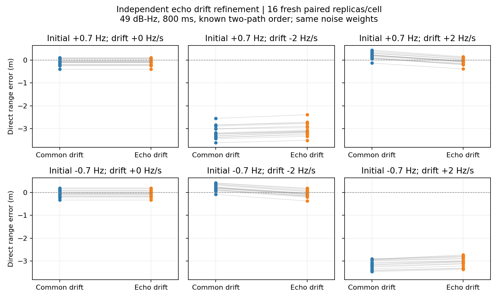

# 反射経路固有のDoppler変化率を推定する

[符号反転実験](cpu_echo_sign_reversal.md)では、相対Dopplerがゼロを横切る条件で
約3.1mの距離偏りが再現した。既存受信器は両経路の搬送波ドリフトを共通と仮定していた。
今回は直接波のドリフトに加え、反射波だけの相対ドリフトを推定する。

## 変更内容

`python/gnss_gpu/relative_drift_paths_cpu.py` は、複素振幅を線形最小二乗で消去した
6変数の推定器である。変数は直接波遅延、共通周波数、共通ドリフト、余剰遅延、
相対Doppler、相対ドリフト。反射波のブロック積分では共通ドリフトに相対ドリフトを加える。
コード遅延は既存同様に固定し、生成側のコード移動との小さな不一致は残す。

既存受信処理から得る重みと2経路推定を使い、重みを再推定せずに追加の最適化を行う。
相対ドリフトの探索範囲は±4Hz/s。それ以外の境界と局所判定基準は既存と同じ。
初期値は相対ドリフト−3, −1.5, 0, +1.5, +3Hz/sと、余剰遅延の既存推定値/0.05/0.2chipの
15通り。相対周波数は観測中央の周波数を保つよう調整する。最大400反復。
真の遅延・Doppler・ドリフトは推定器へ渡さない。

複素振幅を含む実パラメータ数は9から10へ増えるため、局所分散推定の自由度を更新した。
この分散は診断値であり、校正された信頼区間ではない。モデル選択スコアやゲートは導入しない。

## 実験設計

新規ID 1390000–1390015の16組を用いる。
初期相対Doppler ±0.7Hz × 相対ドリフト0, ±2Hz/sの6条件で、計96観測。
条件間で雑音・初期遅延/位相・発振器外乱を共有する。前回データとは合算しない。
49dB-Hz（単位利得フィルタ前）、800ms、片側帯域7.3656MHz、PRN1、反射電圧比0.8、
初期余剰遅延0.03chip、相対位相π。生成器はコードと搬送波を同一の二次経路長に連動させる。

各観測に既存受信処理と追加推定を適用し、距離誤差、局所判定、10m未満の成功率を比較する。
2経路の存在は既知。推定した相対ドリフトの誤差も記録する。探索実験で有意差検定は行わず、
成功率の区間は点ごとのClopper–Pearson 95%区間とする。

並列評価後に1回ウォームアップし、ゼロ交差の2条件から先頭1組ずつを直列で計測する。
既存処理全体と追加推定の所要時間を分けて記録する。2件の記述的計測であり、
実時間動作や一般的な速度を保証するベンチマークではない。

## 結果

| 初期Doppler (Hz) | 相対ドリフト (Hz/s) | 既存の絶対誤差中央値 (m) | 追加推定後 (m) | 相対ドリフト絶対誤差中央値 (Hz/s) |
|---:|---:|---:|---:|---:|
| +0.7 | +0.0 | 0.097 | 0.097 | 0.022 |
| +0.7 | -2.0 | 3.220 | 3.110 | 1.300 |
| +0.7 | +2.0 | 0.207 | 0.096 | 0.026 |
| -0.7 | +0.0 | 0.092 | 0.092 | 0.016 |
| -0.7 | -2.0 | 0.208 | 0.105 | 0.013 |
| -0.7 | +2.0 | 3.131 | 3.018 | 1.386 |

ゼロ交差しない加速条件では、距離誤差中央値が約0.21mから約0.10mへ下がった。
しかしゼロ交差する2条件は3.220→3.110m、3.131→3.018mにとどまり、主要な偏りは残った。
この2条件の相対ドリフト推定誤差中央値も1.30–1.39Hz/sと大きい。
両受信器とも全条件16/16で10m基準を満たしたが、これを偏り解消とは扱わない。
各成功率の点ごとの95%区間は79.4–100%。

追加パラメータの局所推定だけでゼロ交差時の問題を解決することはできなかった。
既存推定を中心とする初期化、共通周波数/ドリフトと相対ドリフトの結合、
固定コード近似・固定重みなど、原因はこの実験では切り分けられていない。
次は同じ観測と重みで共通周波数/ドリフトを含む初期値探索を広げ、より低い
残差と小さい距離誤差の解が存在するかを診断する。真値を初期値には使わない。
検証前にこの追加推定を既定の受信処理へ組み込むことはしない。



直列2件の時間中央値は既存処理4.09秒、追加推定1.71秒、合計5.80秒（既存の約1.42倍）。800ms信号に対し実時間処理には達していない。

出力：`output/cpu-relative-drift-pilot/`。テスト8件が通過。全96観測と各条件の再実行を監査し、記録を`audit.json`に保存する。

## 再現と検証

```bash
source /workspace/.gnss-env/activate.sh
pytest -q tests/test_relative_drift_paths.py tests/test_accelerating_echo_cpu.py tests/test_bandwidth_drift_paths.py
# 出力先は空であること。完了した実験を上書きしない。
python -m experiments.run_cpu_relative_drift_pilot
python -m experiments.audit_cpu_relative_drift_pilot
python -m experiments.plot_cpu_relative_drift_pilot
```

テストではゼロ相対ドリフト時の旧目的関数・既存5成分の勾配との完全一致、
正負の相対ドリフトでの数値微分との一致、独立した複素最小二乗との一致を確認する。
監査は全96観測のハッシュと評価指標、各条件1件の全推定再実行と局所分散の再計算を含む。
ソースとプロトコルはデータ生成前にハッシュ固定する。

## 限界

既知2経路・高C/N0・合成調波観測の限定的な評価である。追加自由度が単一路信号の
過適合や経路数の誤判定に与える影響は未検証であり、既存ゲートを流用してはならない。
固定コード遅延近似と、既存モデル由来の残差重みの影響も残る。
RFビン間漏れ、森林の幾何・反射振幅変動、降雨、実測信号、多衛星PVTは含まない。
