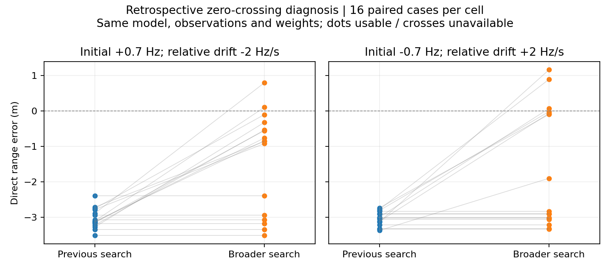

# 反射Dopplerドリフト推定の初期値探索を広げる

[相対ドリフト推定の試験](cpu_relative_drift_pilot.md)では、パラメータを追加しても
ゼロ交差条件の約3mの距離偏りが残った。今回、同じモデル・観測・雑音重み・探索境界・
局所判定で初期値探索を広げ、より小さい残差の解が存在するか調べた。

## 診断設計

前回のゼロ交差32件を全件使用し、他の4条件から先頭2組ずつ、計40件を選ぶ。
既存データを用いた遡及的な原因調査であり、新しいデータでの性能実証ではない。
誤差の大きさで個別の採否を決めず、対象条件の全件を含める。

`python/gnss_gpu/broad_relative_drift_cpu.py` は次の格子から729候補を評価する。

- 直接波遅延：既存推定値から−0.05, 0, +0.05chip（境界内に制限）
- 余剰遅延：既存推定値、0.05, 0.2chip
- 共通周波数：−1.5, 0, +1.5Hz
- 共通ドリフト：−2, 0, +2Hz/s
- 相対Doppler：−2, 0, +2Hz
- 相対ドリフト：−3, 0, +3Hz/s

共通周波数・共通ドリフト・相対ドリフトの各組合せで残差最小の候補を1つ選び、
27初期値を確保する。既存の推定点も加え、28回の局所最適化を最大400反復で行う。
最適化前の既存解も最終候補として保持する。真の遅延、Doppler、ドリフトは渡さず、
残差によって解を選ぶ。数値的に同等の候補は既存の収束判定ヘルパーで扱う。

出力先：`output/cpu-relative-drift-search/`。実行前に対象タスク、変更ソース、
継承ソースと既存結果のハッシュを保存する。残差改善の記述的な閾値は相対1e-9。
有意差検定や信頼区間による新規性能主張は行わない。

## 結果

| 初期Doppler (Hz) | 相対ドリフト (Hz/s) | 件数 | 残差が明確に下がった件数 | 絶対距離誤差中央値：従来→拡張 (m) |
|---:|---:|---:|---:|---:|
| +0.7 | +0.0 | 2 | 0 | 0.052 → 0.052 |
| +0.7 | -2.0 | 16 | 10 | 3.110 → 0.853 |
| +0.7 | +2.0 | 2 | 0 | 0.040 → 0.040 |
| -0.7 | +0.0 | 2 | 0 | 0.068 → 0.068 |
| -0.7 | -2.0 | 2 | 0 | 0.077 → 0.077 |
| -0.7 | +2.0 | 16 | 7 | 3.018 → 2.867 |

ゼロ交差32件のうち17件で、同じモデルと重みのまま残差が下がった。
この17件は距離誤差も減少した。少なくともこれらのケースでは、以前の探索がより良い解を
見逃していたことが確認できる。モデルに相対ドリフトを追加しても改善しなかったという
前回の結果を、モデル能力だけの限界として解釈するべきではない。

ただし15件では明確な残差改善がなく、初期Doppler−0.7Hz・相対ドリフト+2Hz/s条件の
距離誤差中央値は約2.87mにとどまった。初期Doppler+0.7Hz側も最大誤差は約3.51mで、
全件解決には至っていない。全40件が収束・局所適合判定を通過したことも、解の正しさや
大域最適性を保証しない。

対照8件では相対1e-9を超える残差改善はなかった。数値的に同等な解の選択により
ごく小さい距離変化はある。対照は各2件だけであり、無劣化の一般的な保証ではない。



次は残った15件を含め、時間区間ごとの搬送波変化から初期値を作るなど、格子を単純に
増やす以外の探索方法を検討する。実用的な改善として採用する前に新規データでの再現性と
計算時間を測る。今回の検証は遡及診断として保存し、既定の受信処理は変更しない。

テスト6件が通過。監査結果は`audit.json`、個別結果は`evaluation.jsonl`に保存する。

## 再現と検証

```bash
source /workspace/.gnss-env/activate.sh
pytest -q tests/test_broad_relative_drift.py tests/test_relative_drift_paths.py tests/test_bandwidth_drift_paths.py
# 空の出力先が必要。保存済みの実験を上書きしない。
python -m experiments.diagnose_cpu_relative_drift_search
python -m experiments.audit_cpu_relative_drift_search
python -m experiments.plot_cpu_relative_drift_search
```

テストは初期値の組合せ・境界・選択規則と、既存の勾配・モデル互換性を確認する。
全40件で生成観測のハッシュ・評価値を照合し、各6条件から1件ずつ探索全体を再実行する。
再実行では密行列による残差と局所分散も検証する。

## 解釈上の制約

有限個の初期値探索であり、大域最適解の保証はない。残差が下がっても、雑音のある信号で
距離誤差が必ず下がるとは限らない。今回のデータに合わせて改良案を評価しているため、
受信器へ採用する前に独立データで再検証する必要がある。
既知2経路、高C/N0、合成調波観測という範囲は変わらない。経路数選択の校正、RFビン間漏れ、
実測、森林・降雨・多衛星PVTの評価は含まない。コード遅延は固定の近似を維持している。
