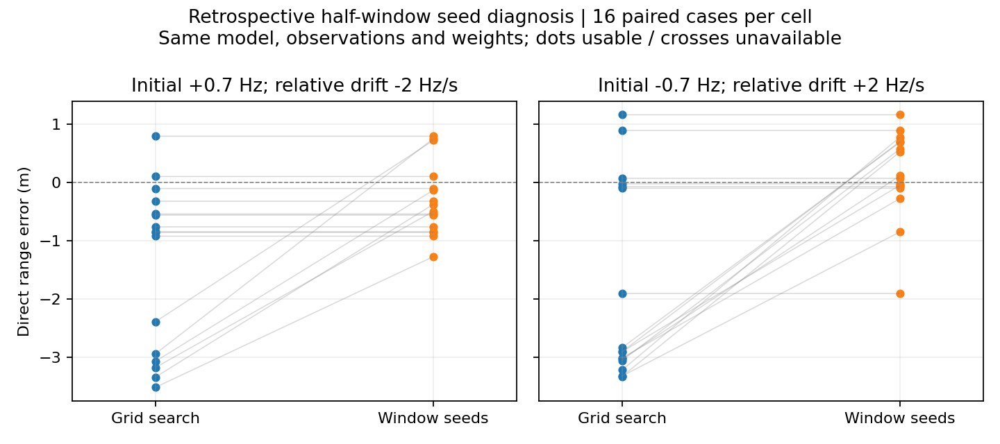

# 時間区間ごとの周波数推定による初期値生成

[格子探索の拡張](cpu_relative_drift_search.md)でゼロ交差32件中17件の残差・距離誤差が
改善した一方、15件には明確な改善がなかった。今回、800msの観測を前後400msに分けて
周波数を推定し、その時間変化から全区間モデルの初期値を作る。

## 方法

`python/gnss_gpu/window_seed_relative_drift_cpu.py` に実装した。
各半区間は2経路のコード遅延と相対周波数を持つモデルで推定し、区間内ドリフトはゼロとする。
複素振幅は半区間ごとに独立に推定するので、後半の時間原点による定数位相は振幅に吸収される。
推定周波数を各区間中央（全区間開始から0.2秒・0.6秒）の近似値として扱う。
これはチャープに対する厳密な等価性ではなく、初期値生成用の近似である。

各区間の探索では既存の空間推定値付近の遅延3点、余剰遅延3点、共通周波数4点、
相対周波数4点を評価する。共通周波数ごとに残差の小さい2初期値を選び、最大8回の
局所最適化を実行する。収束した解から残差順に最大3個を残す。
区間中央での周波数範囲を覆うよう、共通周波数は±4Hz、相対周波数は±15Hzとする。
これは初期値生成専用で、全区間の推定境界は変更しない。

前半・後半の最大9組の周波数から、例えば共通ドリフトを
`a=(f_right-f_left)/0.4`、初期共通周波数を`f0=f_left-0.2*a`と計算する。
相対Dopplerにも同じ変換を行い、全区間の既存境界へ制限する。空間パラメータは
両区間の平均を使う場合と既存値を維持する場合の2通りを用意する。
既存解からの再最適化も加え最大19初期値とし、最適化前の既存解も候補として保持する。
真のパラメータや誤差を解の選択には使わない。

## 固定した評価条件

前回診断の40件すべてを使用する。ゼロ交差32件と、他の4条件から各2件の対照である。
前回改善がなかったゼロ交差15件の結果も別に集計する。信号、雑音重み、全区間モデル、
探索境界、局所適合判定は固定し、初期値生成だけを変更する。
相対残差の改善閾値は1e-9。既存データの遡及診断であり、独立な性能実証ではない。

全区間受信器はコード遅延を固定している。信号生成器はコード・搬送波を同一の二次経路長に
連動させるため、このモデル不一致は残る。既知2経路、49dB-Hz、800ms、PRN1、
片側7.3656MHz、反射比0.8、初期余剰遅延0.03chip、初期相対位相πという限定条件である。

## 結果

| 初期Doppler (Hz) | 相対ドリフト (Hz/s) | 件数 | 残差改善 | 絶対誤差中央値：格子→区間初期値 (m) | 最終最大絶対誤差 (m) |
|---:|---:|---:|---:|---:|---:|
| +0.7 | +0.0 | 2 | 0 | 0.052 → 0.052 | 0.058 |
| +0.7 | -2.0 | 16 | 6 | 0.853 → 0.636 | 1.274 |
| +0.7 | +2.0 | 2 | 0 | 0.040 → 0.040 | 0.051 |
| -0.7 | +0.0 | 2 | 0 | 0.068 → 0.068 | 0.079 |
| -0.7 | -2.0 | 2 | 0 | 0.077 → 0.077 | 0.097 |
| -0.7 | +2.0 | 16 | 9 | 2.867 → 0.545 | 1.900 |

前回の格子探索で明確な改善がなかったゼロ交差15件すべてで残差が下がり、15件すべてで
絶対距離誤差も減った。前回格子探索で改善した17件と合わせ、この32件では従来の
相対ドリフト推定より小さい残差の解が見つかった。今回の結果は初期値探索の重要性を示すが、
大域最適性や未知データでの改善は保証しない。

ゼロ交差2条件の最終絶対誤差中央値は0.636mと0.545m、最大絶対誤差は1.274mと1.900m。
約3mの偏った解からは改善したものの、誤差がなくなったわけではない。
全40件は収束・局所適合判定を通過した。対照8件には相対1e-9を超える残差改善はなかった。



次は、この探索手順を固定して新しい雑音・初期条件のデータで比較し、改善の再現性と
追加計算時間を評価する。現在は既存40件での遡及診断であり、実測性能や研究上の新規性を
実証したものではない。既定の受信処理への統合は行っていない。

テスト5件が通過。監査は全40件と6条件の全探索再実行を含み、結果を`audit.json`に保存する。

## 再現・検証

```bash
source /workspace/.gnss-env/activate.sh
pytest -q tests/test_window_seed_relative_drift.py tests/test_relative_drift_paths.py tests/test_broad_relative_drift.py
# 空の出力先のみ使用可能。過去の結果を上書きしない。
python -m experiments.diagnose_cpu_window_drift_search
python -m experiments.audit_cpu_window_drift_search
python -m experiments.plot_cpu_window_drift_search
```

テストで時間原点を含む周波数・ドリフト変換、後半区間の制限付き目的関数の勾配、
継承した目的関数と格子探索を検証する。監査は40件の信号ハッシュと評価指標、候補数の整合性、
6条件各1件の探索全体の再実行と密行列による残差・局所分散検証を含む。
出力は`output/cpu-window-drift-search/`に保存する。

有限初期値からの探索に大域最適性の保証はない。区間内の周波数変化、干渉、区間ごとの
経路同定の不安定さが初期値に影響する。実測データ、経路数選択の校正、RFビン間漏れ、
森林・降雨・多衛星PVTの評価は今回の対象に含まない。
