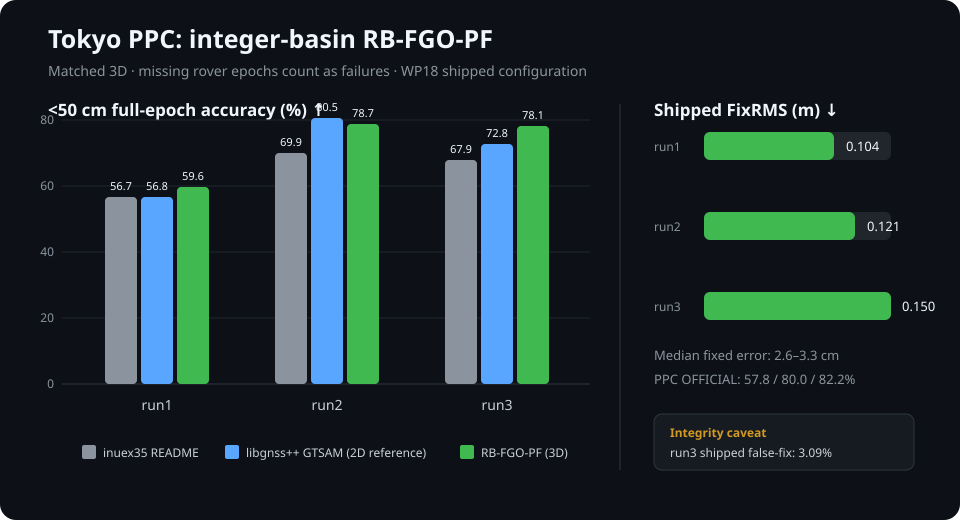

# RB-FGO-PF technical report: integer-ambiguity particle filtering on a shared factor graph

Status as of WP61 (2026-10-18; WP61 is a negative result). Code: [`experiments/rbpf_fgo/`](../experiments/rbpf_fgo/README.md).
Run-by-run record: [`internal_docs/inuex35_tc_fgo_benchmark.md`](../internal_docs/inuex35_tc_fgo_benchmark.md).
Decisions: D-040 to D-060 in [`internal_docs/decisions.md`](../internal_docs/decisions.md).

## Summary

RB-FGO-PF is a Rao-Blackwellized particle filter for urban RTK. One fixed-lag
GNSS/IMU factor graph (GTSAM) keeps every carrier ambiguity float. The
particles carry only integer hypotheses ("basins"), so a wrong fix competes
with the right one through accumulated likelihood instead of being locked in
by a single ratio test. A label layer decides when to report FIX: a
hysteresis rule on the particles' per-pair agreement, held only while the
fix stays within 0.5 m of the graph's float (WP56), then an integer carry
that keeps an accepted integer set while the carrier stays locked. For
post-processing, a second pass runs the same filter backward in time, its
fixes are added where the forward label confirms them, and on epochs that
stay unfixed the position that best fits the carrier modulo whole cycles is
reported (WP54). That output scores 86.3% PPC OFFICIAL averaged over the six
runs. It uses future data, so it falls outside the PPC2024 rules (real time,
no future observations). The real-time output follows those rules and scores
81.6%. The winner scored 85.6% on the challenge's hidden half of the data and
78.7% on the public half.

Running several forward filters side by side and choosing among their
positions epoch by epoch, still in real time, lifts that to 84.7% (WP59: four
runs, map-free). Adding three runs that drop or down-weight satellites a 3D
city model (PLATEAU) puts out of line of sight gives 86.3% (WP60). The
choice and a height correction are trained leave-one-run-out on these six
runs, which challenge participants could not do. Our first and second time
halves score 83.3% and 90.3%; the challenge's split is not public.

On the six PPC 2024 runs (Tokyo 1–3, Nagoya 1–3), three seeds each, with one
scorer for every system:

| Correct FIX / rover epochs (wrong FIX / FIX) | Tokyo 1 | Tokyo 2 | Tokyo 3 | Nagoya 1 | Nagoya 2 | Nagoya 3 |
|---|---:|---:|---:|---:|---:|---:|
| inuex35 TC-FGO (starting point, local reproduction) | 46.7% (5.72%) | 59.7% (1.78%) | 58.2% (2.06%) | – | – | – |
| libgnss++ GTSAM FGO | 37.7% (29.9%) | 77.3% (1.57%) | 68.2% (1.56%) | – | – | – |
| libgnss++ KF-RTK (`ppc-demo`, low-cost preset) | 68.0% (8.76%) | 76.7% (1.80%) | 71.6% (3.01%) | 64.9% (14.8%) | 48.6% (2.15%) | 29.8% (29.4%) |
| **RB-FGO-PF WP56, real time** | **62.9% (0.04%)** | **82.2% (0.02%)** | **78.6% (0.00%)** | **70.5% (0.00%)** | **52.0% (0.07%)** | **30.8% (0.00%)** |
| **RB-FGO-PF WP56, 15 s fixed lag** | **67.3% (0.04%)** | **85.7% (0.02%)** | **82.5% (0.00%)** | **75.3% (0.00%)** | **55.4% (0.07%)** | **40.9% (0.00%)** |
| **RB-FGO-PF WP57, forward + backward (post-processed)** | **69.6% (0.10%)** | **87.1% (0.02%)** | **85.3% (0.02%)** | **79.9% (0.00%)** | **56.9% (0.18%)** | **54.9% (0.14%)** |

Every seed of every run stays at or below 0.08% wrong in real time and with
the 15 s lag, and at or below 0.24% with the backward pass (worst: Nagoya 2).
WP50, without the float check, had 0.20% and 0.35%.
The real-time output never uses future data. The fixed-lag output also
carries integer sets backward from fixes up to 15 s later. The post-processed
output uses the whole run.

Scoring note: the WP50 numbers first published (real time 61.8 / 82.5 /
77.9 / 70.4 / 51.1 / 29.7%, 15 s lag 65.3 / 85.0 / 81.1 / 74.6 / 54.2 /
38.4%) also dropped carried epochs that failed the PF's output guard
(reported position more than 5 m from the code-only position). The `.pos`
output keeps them. This report scores the output as written
(`score_label.py`); the wrong-FIX rates move by at most 0.01 pp, and WP48 and
earlier are unaffected.

<p align="center">
  
</p>

## Evaluation protocol

- **Data.** PPC 2024 public runs: Septentrio mosaic-X5 rover at 5 Hz, 1 Hz
  base, 100 Hz MEMS IMU, 5 Hz ground truth. Tokyo 1–3 and Nagoya 1–3.
- **Correct FIX.** An epoch labelled FIX whose 3D error is under 0.5 m. The
  denominator is every rover epoch, including outages.
- **Wrong FIX.** A FIX with 3D error of 0.5 m or more, as a share of all FIX.
  The target was at most 1% per run and seed.
- **Seeds.** RB-FGO-PF is stochastic, so every configuration is run with
  three seeds (20260710–12). Single-seed differences on Nagoya are often
  within the ±3 pp seed spread, so decisions use three seeds.
- **PPC OFFICIAL.** The challenge's position-only score: the share of
  distance travelled (reference speed × epoch interval, so stops do not
  count) with 3D error within 0.5 m, averaged over the six runs. It does not
  depend on the FIX label.
- **PPC2024 rules.** The challenge required real-time processing: an epoch
  may use past observations, never future ones. Teams were ranked on a
  hidden half of the six runs (private score). The winner (TURING) scored
  85.6% private and 78.7% public. During the challenge, participants had
  ground truth only for two separate training runs, not for these six.
  - **Comparable here:** only the real-time output, scored on all six runs.
    It was developed with these runs' ground truth.
  - **Outside the rules:** the 15 s lag and post-processed outputs, which
    use future data.
  - **Map-aided (WP60):** real time, but it also uses a 3D city model, which
    is reported separately from the map-free numbers.

  Sources: [overview](http://taroz.net/data/PPC2024.pdf),
  [results](http://taroz.net/data/PPC2024_results.pdf).
- **External engines.** libgnss++ and the inuex35 reproduction are scored by
  the same script. No external engine feeds the RB-FGO-PF FIX label.

## Method

### Shared float graph

A fixed-lag smoother holds pose, velocity and IMU bias per epoch
(CombinedImuFactor preintegration), DD pseudorange and DD carrier factors with
per-satellite single-difference ambiguity states, non-holonomic and
zero-velocity constraints, and a Doppler velocity prior. Integers are never
fixed inside the graph, except through PF feedback (below).

Measurement model as shipped:

- **Satellite set (WP45).** Two bands per system, BeiDou B1I + B3I, GLONASS
  off. With three bands requested, cssrlib's quality check had dropped every
  satellite missing any one band (Tokyo run1: 15 of 25 usable satellites).
- **One-band satellites (WP47).** A satellite with one usable band adds its
  pseudorange only (sigma ×10), is never the DD reference, and its pair
  residuals are charged to it alone. Charging them to the reference as well
  had gated or quarantined the reference and dropped every carrier pair of
  its system.
- **Robust weighting (WP48).** Huber losses on DD pseudorange and carrier,
  and a C/N0 term in the pseudorange variance.
- **Doppler (WP48).** A per-satellite Doppler least-squares solve without
  GLONASS and BeiDou GEO, C/N0-weighted, with the lever-arm rotation term and
  its own covariance as the prior. BeiDou GEO Doppler was 3–22 m/s off the
  reference velocity and had biased the old prior by about 0.4 m/s
  vertically. Horizontal p95 velocity error: 2.0 → 0.4–0.5 m/s.

### Particles over integer basins

Each epoch, the graph's joint marginal of position and DD ambiguities gives a
float `(y, Q)`. MLAMBDA proposes the top-K integer candidates (K = 12), and
64 particles move: survive, extend a basin by conditional rounding, adopt a
consensus subset or a full candidate, or release. Each particle's weight
gains the tempered likelihood of the epoch's DD pseudorange and carrier
under its integers (epoch-local robust least squares). Particles are
resampled when the effective sample size drops below N/2. Integers the
particles agree on are held in the shared graph, and released when the PF
withdraws its mass. Each lineage keeps its own IMU-predicted position
belief; the MAP basin's belief is the reported position (WP43). Slips and
outages in the graph remove the affected ambiguity from every particle in
the same epoch. Basins survive graph re-seeds (WP45).

### FIX label (WP50, WP56)

A wrong basin is the true trajectory shifted by a fixed offset. While the
satellite geometry is static, carrier phase cannot reveal it, and in urban
canyons the code is biased the same way for tens of seconds. A separately
tuned KF-RTK route in this repository (libgnss++ WP176, Tokyo run1 54.4% /
Nagoya run1 69.4% correct FIX at ~0% wrong) reaches the same wall. What
per-epoch labels ignored is time:

- Wrong fixes come in short flickers. Dropping fixes in runs shorter than
  2 s cut Nagoya 2's wrong share from 0.54% to 0.04%.
- A correct integer set stays valid for as long as the carrier stays locked.

The label therefore has three parts:

1. **Entry.** At least 15 DD pairs whose MAP integer holds more than 0.99
   of the particle mass (among all particles, or among the non-empty basins
   with mass 0.1+), or the graph's own LAMBDA fix with 5+ ambiguities. The
   DD-pseudorange quality must be at most 1.0, and the PF's position guards
   must agree. This must hold for 5 consecutive epochs (1 s).
2. **Stay.** FIX continues while 6+ pairs agree above 0.90, bridging up to
   2 failed epochs.
   Entry and stay also need the reported position within 0.5 m of the
   graph's float (WP56, below).
3. **Integer carry.** When the label drops, the last FIX epoch's
   single-difference integers are kept while a carrier-only least squares
   still fits them: 8+ pairs, 0.15-cycle slip check, new satellites admitted
   within 0.10 cycle. The epoch is reported FIX at the carried-integer
   position. `integer_smoother.py` runs the same carry backward from later
   fixes, which gives the 15 s fixed-lag output.

The carry is seeded only from hysteresis-labelled epochs. Seeded from the
plain entry rule, it propagated that rule's wrong fixes (Nagoya 2: 146 wrong
carried epochs, seed 20260710). Seeded from the hysteresis label, no carried
epoch came from a wrong source. The label layer does not feed back into the
PF, so it can be replayed on a recorded run (`replay_carry.py`); the replay
is bit-identical to the live run.

### Backward pass (WP51)

The filter only runs forward. For the post-processed output, the same
configuration also runs on a time-mirrored copy of the run
(`wp16_run_rbpf.py --reverse 1`, `reverse_time.py`):

- epoch times become τ = t_first + t_last − t, so the last epoch comes first;
- Doppler, satellite velocity and gyro rates are negated; specific force,
  pseudorange and carrier phase are unchanged;
- satellite orbits and clocks are evaluated at the true transmission time;
- each LLI slip flag moves to the satellite's previous observation;
- IMU samples get mirrored stamps.

The vehicle then drives backward, so the bootstrap heading is turned by π,
and the IMU bias comes from the first parked window instead of the first
5 s (WP57, below).
The GNSS-only bootstrap is 20 s instead of 40 s, and hands over to Phase 2
early if its smoother wedges. Both switches are off in forward runs, which
stay bit-identical (checked on Tokyo 2). On the last 300 s of Tokyo 2 the
backward pass labels 98.1% correct FIX with no wrong fix (forward: 99.0%).

`combine_fb.py` joins the two passes on the forward run's epochs:

1. backward integer carry from the forward label, with no lag limit;
2. a backward FIX segment is added where that label is FIX within 0.3 m of
   it on at least 5 of its epochs and never further away; where the labels
   disagree, the forward one wins;
3. integer carry both ways from every FIX epoch.

Backward fixes are never used unconfirmed. Both passes converge to Nagoya
2's wrong basin, so agreement between them is no evidence there, and the
backward label alone is less safe than the forward one (below). The
threshold of 5 agreeing epochs is not critical: 1 and 10 give the same
results within 0.2 pp.

### Float positions in the post-processed output (WP54)

PPC OFFICIAL weights each epoch by the distance travelled, and does not care
whether a position is labelled FIX. Weighted that way, the WP51 output lost
most of its distance on unfixed epochs more than 0.5 m off: 15 / 5 / 7 / 21
/ 41 / 18% of the distance on Tokyo 1–3 / Nagoya 1–3. The two passes are
often wrong in different places: taking the better of the forward and
backward positions on each epoch would score 87.0% on average, and adding
each pass's graph float as a candidate 90.1%.

Without truth, `combine_fb.py` ranks five candidates on each unfixed epoch
(forward, backward, their mean, forward float, backward float) by the
ambiguity function of the raw DD carrier:

    AF(x) = mean over pairs of cos(2π · frac(b0 − J·(x − pos0)/λ)),

where b0 is the DD carrier minus the DD range at the float position pos0, so
a position near the truth leaves near-integer residuals. AF is averaged over
±5 epochs (±1 s), and the forward position stays unless another candidate
beats it by more than 0.1. FIX labels and FIX positions do not change.

Other selectors, on the same 18 runs:

| PPC OFFICIAL, mean of 6 runs | |
|---|---:|
| WP51 output | 81.5% |
| candidate whose pass fixed more recently | 82.3% |
| candidate closer to the code-only position | 82.6% |
| leave-one-run-out classifier, no AF | 85.2% |
| AF, single epoch, no margin | 85.2% |
| **AF, ±5 epochs, margin 0.1 (shipped)** | **85.9%** |
| leave-one-run-out classifier with AF features | 86.3% |
| oracle over the five candidates | 90.1% |

The shipped rule needs no training data. The nine AF variants tried
(window 0 / ±2 / ±5 epochs, margin 0 / 0.05 / 0.1) all scored 85.1–85.8%.

### Real-time position choice (WP55)

The same choice runs live (`wp16_run_rbpf.py --af-select 6`, the default
`RBPF_SHIP=wp55`), among candidates available causally: the reported
position, the graph float, and the PF's MAP and mixture tracked beliefs. AF
is averaged over the last 6 epochs (1.2 s), and the margin is 0.1. Picking
the best of these four on every epoch would raise the real-time PPC
OFFICIAL from 79.9% to 84.0%; the AF rule reaches 81.6%:

| PPC OFFICIAL, real time | Tokyo 1 | Tokyo 2 | Tokyo 3 | Nagoya 1 | Nagoya 2 | Nagoya 3 | mean |
|---|---:|---:|---:|---:|---:|---:|---:|
| WP50 | 84.3% | 93.8% | 91.8% | 74.5% | 56.1% | 78.8% | 79.9% |
| WP55 | 85.5% | 93.7% | 92.3% | 77.2% | 57.5% | 83.7% | 81.6% |

FIX labels and the filter are unchanged, and the live selection equals an
offline causal replay (`af_select.py`) on the row dump. Seven window /
margin variants scored 81.7–82.1% (scratch weighting).

### Float-consistency check (WP56)

The label rules were chosen on the forward runs, so the backward runs are a
test they were not tuned on. As first measured, the WP50 label was wrong on
4.0–5.3% of backward Tokyo 3 fixes, 1.2% on Nagoya 1 and 0.9% on Nagoya 2.
The Tokyo 3 figure came from a backward-pass IMU bias bug, fixed in WP57
(below); with the fix, backward Tokyo 3 is at 0.06%. The numbers in this
section use the WP57 backward runs.

Of the 342 wrong backward FIX epochs (18 runs), 170 have the fix 0.5 m or
more from the graph's float; on the forward runs, 17 of 38. Most of them are
on Nagoya 1. There the backward float is 90–190 m off for 3 minutes (WP57
explains why), and the backward PF keeps its FIX label while the fixed
position drifts away from the float.

WP56 gives no label (entry or stay) while the reported position is more than
0.5 m from the graph's float (`--fix-flt-max 0.5`). The threshold is the
correct-FIX tolerance, not a tuned value. The integer carry is not vetoed,
because it rests on the carrier alone. Vetoing it as well cost 13 pp on the
pre-WP57 backward Tokyo 3 run without lowering its wrong share.

| Correct FIX (worst-seed wrong / FIX) | Tokyo 1 | Tokyo 2 | Tokyo 3 | Nagoya 1 | Nagoya 2 | Nagoya 3 |
|---|---:|---:|---:|---:|---:|---:|
| forward, WP50 | 63.1% (0.05%) | 82.8% (0.03%) | 78.8% (0.00%) | 70.6% (0.00%) | 52.2% (0.20%) | 31.0% (0.12%) |
| forward, WP56 | 62.9% (0.04%) | 82.2% (0.03%) | 78.6% (0.00%) | 70.5% (0.00%) | 52.0% (0.08%) | 30.8% (0.00%) |
| backward, WP50 | 62.3% (0.09%) | 82.1% (0.00%) | 80.2% (0.06%) | 64.5% (1.23%) | 53.7% (1.02%) | 42.9% (0.10%) |
| backward, WP56 | 61.9% (0.10%) | 81.4% (0.00%) | 80.0% (0.07%) | 61.0% (0.04%) | 53.2% (1.02%) | 41.3% (0.10%) |

The check does not remove Nagoya 2's wrong basin: its float sits in the same
basin, 0.05 m from the fix.

Thresholds from 0.3 to 1.0 m:

| Threshold | none | 1.0 m | 0.75 m | 0.6 m | **0.5 m** | 0.4 m | 0.3 m |
|---|---:|---:|---:|---:|---:|---:|---:|
| forward correct FIX, 6-run mean | 63.1% | 63.0% | 62.9% | 62.9% | **62.8%** | 62.8% | 62.6% |
| backward worst-seed wrong, Nagoya 2 aside | 1.23% | 0.12% | 0.10% | 0.10% | **0.10%** | 0.23% | 0.10% |

Picked leave-one-run-out instead, it misses the Nagoya 1 failure:

- Each fold holds out both directions of one run. Training runs must stay at
  or below 1.0% wrong, pooled over seeds.
- Five folds pick 1.0 m.
- The Nagoya 1 fold picks no check and gets 1.16% wrong on backward Nagoya
  1, because no other run has the failure.

Effects downstream, measured before WP57 (on the WP51 backward runs):

- **15 s lag.** Correct FIX drops 0.1 pp on average (Nagoya 3: 41.6 → 40.9%);
  worst-seed wrong goes from 0.19% to 0.08%.
- **Post-processed.** The mean is unchanged at 72.1%. Nagoya 3 loses 0.9 pp.
  Worst-seed wrong goes from 0.35% to 0.24%.
- **PPC OFFICIAL.** It moves by at most 0.07 pp: real time 81.6%,
  post-processed 85.9%.

The forward numbers replay the label on the WP48 row-dump runs
(`replay_carry.py --flt-max 0.5`). That replay equals live
`RBPF_SHIP=wp56` runs on the first 1,500 epochs of Tokyo 1, Tokyo 3 and
Nagoya 3 (seed 20260710), including the 3 and 4 epochs the check removes
there. The backward numbers replay the label on WP50-configured backward
runs. There, on the epochs the live carry held (about 5%), the PF's own
position was not stored, so the check uses the carried position.

### Backward-pass IMU bias (WP57)

At the hand-over from the GNSS-only bootstrap to the IMU graph, the IMU bias
is estimated from the first 5 s of IMU data, assumed parked. A backward pass
starts at the run's end. Tokyo 3 ends mid-turn (yaw rate 4 deg/s), so the
backward gyro z bias came out at −4.5 deg/s instead of about +0.02 deg/s. The
bias random walk is too tight to recover, so the error stayed for the whole
run.

With `--reverse` the bias now comes from the first 5 s window whose per-axis
gyro and accelerometer standard deviations stay under 0.5 deg/s and
0.2 m/s² (`IMU_STATIC_SEARCH=1`). On backward Tokyo 3 that window is 60 s
in, and on Tokyo 1 2.5 s in. The other four runs end parked, so their
backward runs are unchanged. Forward runs are unchanged (the option is off
there, and every run starts parked).

| Backward pass, 3 seeds | Tokyo 1 | Tokyo 3 |
|---|---:|---:|
| graph float within 0.5 m, before → after | 82.9 → 84.0% | 52.1 → 93.6% (forward 94.5%) |
| correct FIX, WP56 label (worst-seed wrong) | 60.8 → 61.9% (0.10%) | 59.9 → 80.0% (0.07%) |
| post-processed correct FIX (worst-seed wrong) | 69.3 → 69.6% (0.18%) | 84.6 → 85.3% (0.05%) |
| post-processed PPC OFFICIAL | 92.0 → 92.1% | 92.9 → 95.2% |

The post-processed PPC OFFICIAL mean rises from 85.9% to 86.3%.

Nagoya 1's backward failure is not a bug:

- In true time 551338–551349 s, satellites 41 and 24 carry 10–20 m
  pseudorange errors (multipath or no line of sight).
- The forward pass met them with carrier ambiguities settled in clean
  epochs, and its float stayed within 0.2 m.
- The backward pass meets them as new arcs: its float drifts 3–4 m, enters an
  18 s outage already 9–20 m off, and leaves it 330 m off.
- After that the graph holds no carrier ambiguity for 3 minutes.

Two fixes were tried on it:

- **Sanity reset.** The DD-pseudorange sanity reset (`--sanity-enable 1`, off
  since WP45) recovers that stretch within 20 s. Over the first 3,300
  backward epochs, though, it lowers the float's within-0.5 m share from 66%
  to 54% and correct FIX from 72.8% to 59.4%.
- **Trimming arc ends.** The idea was to drop each arc's last epochs, on the
  view that tracking degrades just before loss of lock. The forward row
  dumps do not support it: pseudorange residuals at arc ends (p90 2.1 m)
  are no worse than at arc starts (2.7 m).

### Real-time ensemble (WP59)

Several forward runs of the filter, each with its own particles, run side by
side on the same epochs. Every member offers four candidates per epoch (its
reported position, graph float, MAP and mixture beliefs). Per epoch,
`rt_ensemble.py` outputs one of them, using this epoch and earlier ones only.

- **Members.** The three seeds of WP56 and one variant that also uses the
  carrier of one-band satellites at 40 dB-Hz or more (seed 20260710; WP58
  found it worse alone, but its errors fall elsewhere).
- **Choice.**
  - Rule (WP55 extended to members): a member's reported FIX first, best
    windowed ambiguity fit among fixing members; otherwise the candidate with
    the best ambiguity fit over the last 6 epochs, if it beats member 0's
    reported position by 0.1.
  - Learned: a gradient-boosted classifier scores every candidate's chance
    of being within 0.5 m from 46 causal features (ambiguity fit over 1–30
    epochs, FIX flags, how many candidates agree within 0.1–0.6 m, PF state,
    time since the last FIX). The model for each run is trained on the
    other five runs only.
- **Height bias.** On epochs without a member FIX the output moves down by
  0.10–0.15 m. Unfixed positions sit high in street canyons: delayed
  reflected signals on the lower satellites lift the double-differenced
  solution (median +0.46 to +1.02 m on the epochs lost to height alone).
  The amount is chosen leave-one-run-out; every fold picks 0.10 or 0.15 m.
- **Rover gaps.** Where the rover file has no epochs (Nagoya 1: 10 s;
  Tokyo 1: short gaps), `wp16_run_rbpf.py --gap-fill` writes IMU
  dead-reckoned positions at 5 Hz, anchored on the output before the gap.
- **FIX label.** FIX where at least two map-free members hold their own
  WP56 label within 0.2 m of the output.

### NLOS from a 3D city model (WP60)

PLATEAU, the Japanese open 3D city model, covers both cities. The building
and bridge meshes along each run are loaded once (2.2–3.6 M triangles per
Tokyo run, heights converted to the ellipsoid with the EGM96 geoid). On each
epoch the filter traces a ray from its IMU-predicted antenna position to
every satellite (`plateau_los.py`, a CPU grid tracer; no GPU). A satellite
whose ray hits a building is NLOS for that epoch. Only this epoch's
prediction is used, so the mask is real time. Map-aided runs differ from
WP56 in three settings:

- **Exclude or down-weight.** NLOS pairs leave the double differences while
  at least 6 satellites stay in line of sight; with fewer, they stay with a
  5× noise sigma (`NLOS_MEAS_MODE=3`). Plain exclusion left too few rows in
  canyons and dropped epochs to dead reckoning.
- **Reference satellite.** Each system's reference is the highest
  line-of-sight satellite (`NLOS_REF_LOS=1`). An NLOS reference would mark
  every pair of its system.
- **Near surfaces.** Rays ignore surfaces within 3 m. Otherwise a bridge
  deck put a surface 1.1 m above the antenna whenever the car drove over a
  bridge (Tokyo 2: zenith blocked on 1,354 of 9,151 epochs; 7 with buildings
  only). An antenna that looks enclosed keeps the previous epoch's set.

27–40% of the satellite-epochs are NLOS (Tokyo 1: 36%, Nagoya 2: 35%). In
Nagoya 2's 375 s street canyon 14–22 of 24–30 satellites are NLOS.

## How the results moved

| Release | Change | Correct FIX (3 seeds) | Worst wrong / FIX |
|---|---|---|---|
| WP43 | lineage-tracked output | Tokyo 35.4 / 64.1 / 68.5% | 0.33% |
| WP45 | two-band satellite set, basin persistence, label from PF agreement | Tokyo 66.6 / 83.9 / 84.3% | Tokyo 0.56%, but Nagoya 2/3 8.5 / 16.2% |
| WP46 | label re-selected on Tokyo and Nagoya | 56.1 / 76.4 / 75.8 / 61.0 / 46.5 / 12.3% | Nagoya 3 6.2% |
| WP47 | one-band satellites, residual-attribution fix | 56.9 / 78.0 / 76.1 / 65.4 / 46.3 / 26.3% | 0.99% |
| WP48 | Doppler v2, Huber, C/N0 weighting | 56.4 / 78.7 / 74.8 / 66.5 / 47.8 / 27.4% | 0.62% |
| WP50 | hysteresis label, integer carry | 63.1 / 82.8 / 78.8 / 70.6 / 52.2 / 31.0% | 0.20% |
| WP50, 15 s lag | backward carry | 67.3 / 85.7 / 82.5 / 75.3 / 55.4 / 41.6% | 0.19% |
| WP51, post-processed | backward PF pass, anchored union, carry both ways | 69.3 / 87.1 / 83.6 / 79.9 / 56.8 / 55.8% | 0.35% |
| WP54, post-processed | ambiguity-fit float selection (positions only) | unchanged | unchanged |
| WP55, real time | ambiguity-fit position choice (positions only) | unchanged | unchanged |
| WP56 | no label while the fix is over 0.5 m from the float | 62.9 / 82.2 / 78.6 / 70.5 / 52.0 / 30.8% | 0.08% |
| WP56, 15 s lag | | 67.3 / 85.7 / 82.5 / 75.3 / 55.4 / 40.9% | 0.08% |
| WP56, post-processed | | 69.3 / 87.1 / 84.6 / 79.9 / 56.9 / 54.9% | 0.24% |
| WP57, post-processed | backward pass: IMU bias from a parked window | 69.6 / 87.1 / 85.3 / 79.9 / 56.9 / 54.9% | 0.24% |

Over the 15 s lag output, WP51's gain splits into three parts:

| Correct FIX, pp added | Tokyo 1 | Tokyo 2 | Tokyo 3 | Nagoya 1 | Nagoya 2 | Nagoya 3 |
|---|---:|---:|---:|---:|---:|---:|
| backward carry without the 15 s limit | 0.0 | 0.0 | 0.0 | 2.2 | 0.1 | 3.6 |
| carry re-seeded from carried epochs | 1.1 | 0.4 | 0.6 | 1.3 | 0.5 | 1.7 |
| backward PF pass | 0.9 | 1.0 | 0.5 | 1.1 | 0.8 | 8.9 |

The backward pass matters most on Nagoya 3, where it fixes 42.9% of epochs on
its own (forward: 31.0%).

PPC OFFICIAL (position only): WP46 80.8 / 92.7 / 90.4 / 65.4 / 55.3 / 20.2%;
WP50 84.3 / 93.8 / 91.8 / 74.5 / 56.1 / 78.8%; WP50 with the 15 s lag
84.6 / 94.2 / 92.4 / 75.0 / 57.8 / 79.4%; WP51 84.8 / 94.7 / 92.9 / 76.3 /
58.8 / 81.5%; WP54 92.0 / 95.6 / 93.0 / 79.5 / 64.2 / 90.9% (mean 85.9%);
real time with WP55 85.5 / 93.7 / 92.3 / 77.2 / 57.5 / 83.7% (mean 81.6%).
WP56 moves these by at most 0.07 pp (post-processed 92.0 / 95.6 / 92.9 /
79.5 / 64.3 / 90.9%, mean 85.9%; real time unchanged at 81.6%). WP57 raises
the post-processed output to 92.1 / 95.6 / 95.2 / 79.5 / 64.3 / 90.9%
(mean 86.3%). The PPC2024 winner (TURING) scored 85.6% under the challenge
rules: real time, ranked on the hidden half of the data (78.7% on the public
half). Only our real-time output follows those rules: 81.6% on all six runs,
3-seed mean, developed with these runs' ground truth. Earlier versions of
this report compared the post-processed output with 85.6%. That comparison
was wrong, because the post-processed output uses future data.

Real time, every output scored by `rt_ensemble.py` (PPC OFFICIAL, all six
runs; "half 1 / half 2" split each run at its middle epoch):

| PPC OFFICIAL, real time | Tokyo 1 | Tokyo 2 | Tokyo 3 | Nagoya 1 | Nagoya 2 | Nagoya 3 | mean | half 1 / half 2 |
|---|---:|---:|---:|---:|---:|---:|---:|---:|
| WP56, one run (3-seed mean) | 85.2 | 93.7 | 92.3 | 77.2 | 57.5 | 83.7 | 81.6 | |
| WP60, one map-aided run (3-seed mean) | 89.7 | 94.4 | 92.8 | 75.4 | 58.5 | 83.2 | 82.3 | |
| WP59: 3 seeds, ambiguity-fit choice | 85.7 | 93.8 | 92.2 | 78.2 | 59.7 | 88.2 | 83.0 | 81.1 / 86.0 |
| + one-band carriers at 40 dB-Hz | 85.9 | 93.9 | 93.0 | 78.6 | 62.1 | 89.1 | 83.8 | 81.6 / 87.1 |
| learned choice | 86.3 | 94.9 | 93.3 | 79.3 | 61.1 | 90.2 | 84.2 | 82.1 / 87.4 |
| + height bias, rover-gap rows (map-free) | 86.9 | 95.8 | 93.7 | 80.2 | 61.1 | 90.4 | **84.7** | 82.4 / 88.1 |
| WP60: + one map-aided run | 91.7 | 96.5 | 94.4 | 81.7 | 62.1 | 90.3 | 86.1 | 83.2 / 90.1 |
| + three map-aided runs, ambiguity-fit choice | 90.9 | 94.8 | 93.5 | 80.6 | 62.1 | 90.5 | 85.4 | 82.4 / 89.5 |
| **+ three map-aided runs, learned choice** | 92.2 | 96.2 | 94.4 | 81.6 | 62.1 | 91.0 | **86.3** | 83.3 / 90.3 |

The FIX label of the ensemble (at least two map-free members fixed within
0.2 m of the output) gives 62.0 / 82.3 / 77.8 / 70.0 / 52.0 / 31.4% correct
FIX at most 0.06% wrong, the same as one WP56 run. The map-aided runs' own
label is not used (Nagoya 2: 5.84% wrong). The learned choice wins on 5 of
6 runs and loses 0.7–1.0 pp on Nagoya 2.

Against PPC2024, which ranked on a hidden half: the map-aided ensemble's
86.3% on all the data is above the winner's 85.6% private score, and its
map-free form (84.7%) is above the winner's whole-data estimate of about
82% (public and private averaged). All three top teams scored higher on the
private half (+2.7 to +6.9 pp); our second halves are likewise the easier
ones. These are not like-for-like: our choice and height bias were trained
on these six runs (leave-one-run-out), and the map-aided form uses a 3D city
model.

## What did not work

Each of these was measured on the same runs and seeds, and is recorded in the
benchmark record:

- **Learned labels.** A gradient-boosting classifier on 60+ causal PF
  features (nested leave-one-run-out) labelled fewer fixes than the rule at
  the same wrong-FIX cap (Tokyo 1: 52.3 vs 56.9%). Agreement-fraction terms
  added 0.3–1.4 pp held out.
- **External witness in the label.** A libgnss++ KF-RTK witness raised the
  FIX rate, but it was removed: the label must come from the PF itself.
- **Wide-lane fixes (WP49).** The WL position is within 0.5 m on 7–30 pp more
  epochs than the FIX label. Neither a per-epoch WL ratio test nor a second
  PF holding WL integer sets over time separates right from wrong WL sets
  where the float is biased (up to 48% wrong on Nagoya 2). WL also does not
  veto Nagoya 2's wrong basin: its position is biased the same way.
- **More particles, tracked-belief weighting.** N = 256 and weighting by the
  tracked position belief did not help.
- **Tighter Doppler before the GEO fix.** It cost up to 6 pp, which is what
  exposed the BeiDou GEO Doppler error.
- **Float-side tweaks alone.** Huber, C/N0 weighting and Doppler v2 cut the
  share of epochs with the float more than 1 m off, but each moved FIX by
  only ±1–2 pp on its own. Together they raised PPC OFFICIAL by 1–8 pp.
- **Unconfirmed backward fixes (WP51).** Adding every backward fix that the
  forward output does not contradict (and dropping both where it does)
  reaches 1.7% wrong on Tokyo 3 and 1.1% on Nagoya 2.
- **Two-filter agreement (WP51).** Reporting FIX wherever both passes' PFs
  report their own fix within 3–10 cm of each other gains about 2 pp on
  Tokyo 1 but reaches 4.5–4.8% wrong on Nagoya 2: both passes settle in the
  same wrong basin.
- **Averaging the two floats (WP51).** It lowers the share of epochs within
  0.5 m on Tokyo 1, Tokyo 3 and Nagoya 1.
- **Holding the carried integers in the graph (WP52).** Forward carry
  episodes last a median of 0.4 s, so the holds rarely act; seed 20260710
  moved Tokyo 1 by +0.2 pp, Nagoya 3 by −3.0 pp and Nagoya 2's wrong share
  from 0.12 to 0.48%.
- **Searching for a common offset with the carrier (WP55).** Shifting the
  last 1 s of the forward trajectory by the offset that best fits the
  carrier modulo whole cycles (±3 m horizontal, ±1.5 m vertical, 5 cm grid)
  lands within 0.5 m on 18% of sampled unfixed Nagoya 2 epochs, against 22%
  for the forward position: with 12–14 pairs the search volume holds many
  spurious peaks. Choosing among a few candidates (WP54/WP55) avoids that.
- **Blending the passes where carrier pairs are scarce (WP55).** Weighting
  forward and backward positions by the time since each pass's last FIX on
  epochs with at most 2–6 pairs gains up to 1 pp on Nagoya 2 but loses
  2–5 pp on Tokyo 3.
- **Recovering backward Nagoya 1 (WP57).** The DD-pseudorange sanity reset
  recovers its 3-minute failure within 20 s but costs 13 pp correct FIX
  elsewhere in the run. Dropping satellites' arc-end epochs was not tried:
  the forward data show no worse residuals there.
- **FIX entry on fewer pairs (WP58).** A second entry branch, at least
  8 / 10 / 12 MAP pairs above 0.99 held for 1 s, adds 2–4 pp on average
  (Nagoya 3 5–11 pp) but marks 4.6–13.5% of Nagoya 2's fixes wrong.
  Required for 5 s or longer, it adds at most 0.1 pp forward (0.8 pp
  backward): so few pairs rarely agree that long. The label side has no safe headroom left.
- **Carrier of one-band satellites (WP58).** In the unfixed epochs with a
  correct position, Tokyo 1 has a median of 5 satellites that carry only
  one band and are used for code only. Counting their carrier would lift
  the share of those epochs with 15+ pairs from 9% to 49%.
  - **All one-band carriers** (seed 20260710): correct FIX falls on all four
    runs tried, for example Tokyo 1 63.2 → 57.2% and Nagoya 3 32.0 → 15.1%
    (float within 0.5 m 69.7 → 18.6%). Nagoya 2 reaches 2.1% wrong.
  - **Why.** At truth those carriers are off an integer by more than 0.25
    cycle on 32–42% of epochs, against 7–24% for two-band ones. They jump
    integer 5–11 times as often (no dual-band slip check is possible).
  - **Only those at 40 dB-Hz or more.** Nagoya 3 PPC OFFICIAL rises 82.7 →
    87.9%. But correct FIX still falls (Tokyo 1 63.2 → 58.7%), Tokyo 1
    OFFICIAL falls 86.1 → 79.7%, and Nagoya 2 has 2.05% wrong.
- **No FIX entry while parked (WP53).** Parked epochs are 33–55% of each run;
  vetoing entry there costs Nagoya 5–15 pp and leaves Nagoya 2's wrong
  basin, which is chosen during a stop but labelled after the vehicle
  moves.
- **Committing epochs with fewer satellites (WP59).** The graph abandons an
  epoch with fewer than 6 common satellites and dead-reckons through it.
  - **4 satellites** (`P2_MIN_NS=4`): +1.4 pp of Nagoya 1's first 1,400
    epochs, but single-member PPC OFFICIAL over the full runs moves −1.0
    (Nagoya 1) and 0.0 (Tokyo 1). The rest of the difference is the usual
    run-to-run spread of the PF. As a fifth member it adds 0.1–0.4 pp.
  - **IMU-only epochs** (`P2_IMU_ONLY=1`; the IMU factor, NHC and ZUPT only):
    58.3% on those 1,400 epochs, against 60.4% for 4 satellites and 59.1%
    shipped. The NHC-constrained states drift faster than a pure IMU
    prediction from the last GNSS epoch (6 s without GNSS: 0.30 → 0.99 m
    against 0.18 → 0.42 m).
  - **Doppler from 2–4 satellites** (clock drift eliminated, `DOP_LOWSAT_SIG`):
    it fired on 3 of those 1,400 epochs.
- **Rover-gap dead reckoning alone (WP59).** +0.3 pp on Tokyo 1 and nothing
  on Nagoya 1: the filter had already abandoned the 4 s before Nagoya 1's
  10 s gap (fewer than 6 satellites), so the gap starts from a stale anchor
  0.59 m off.
- **Other position rules (WP59).** Carrying the last FIX's offset from the
  float into later float epochs moves the ensemble by −0.2 to +0.07 pp.
  Taking the medoid or the median of the members' candidates loses
  1.5–2.1 pp against the ambiguity-fit choice. A libgnss++ KF-RTK member adds
  0.1 pp and is not used (external engine).
- **Plain NLOS exclusion (WP60).** Excluding every map-NLOS pair leaves
  canyon epochs with fewer than 4 rows, which the graph abandons (Nagoya 2:
  dead reckoning on 10% of the first 3,000 epochs against 2%). A mask traced
  from a first, map-free pass's positions (meters off in canyons) gains
  0.6–0.7 pp on Nagoya 2 alone but loses 2.4 pp of Tokyo 1's first 4,500
  epochs when it excludes.
- **The map-aided filter's own FIX label (WP60).** On Nagoya 2 it marks
  5.84% of its fixes wrong (3 seeds, worst 7.06%). The 0.95 m wrong basin
  holds more firmly: the satellites the map removes include those that
  disagreed with it. The ensemble label therefore uses only the map-free
  members.
- **3D-map candidate scoring (WP61).** In Nagoya 2's canyon, a grid of
  candidates around the real-time output was scored by how well each
  candidate's PLATEAU LOS / NLOS states fit the code residuals. Variants
  added C/N0 and the delay of the shortest single-bounce wall reflection
  (`plateau_reflect.py`), with densities calibrated on Tokyo. The best
  candidate is 1.8–2.0 m off (median, horizontal), against 1.85 m for the
  output, and 1.8 m even with the grid centred on the truth.
  - **What holds up.** The map's LOS states are reliable: at the truth,
    map-LOS satellites are within 0.3–0.7 m (median), map-NLOS ones 14–18 m
    off in the canyon.
  - **What does not.** The predicted reflection delays are poor
    (correlation 0.18–0.56 with the measured error, 1.4–5.6× too large
    outside the canyon).
  - **As a selector feature.** Of the ensemble's 3.3 pp loss against an
    oracle choice, only 0.45 pp lies where the right candidate is more than
    1.5 m from the output.
  - **Carrier.** At the truth the canyon has 7 of 19 satellites in line of
    sight. That leaves a median of 3 LOS carrier pairs per epoch (4 with a
    reference shared by GPS, Galileo and QZSS), too few for carrier
    positioning.

## Limits

- **In-sample label selection.** The entry and hysteresis rules were chosen
  on the same six runs. Leave-one-run-out, 5 of 6 folds pick the shipped
  rule and stay at or below 0.01% wrong held out. The Nagoya 2 fold picks a
  1-epoch entry and gets 2.6% wrong, because nothing in its training runs
  shows why the entry delay is needed. The 1 s entry is fixed by design.
  The backward pass is a further check. With the WP57 bias fix, the WP50
  label is wrong on at most 0.10% of backward fixes, except Nagoya 1 (1.23%)
  and Nagoya 2's basin (1.02%). WP56's float check, found on that data,
  brings Nagoya 1 to 0.04%. The backward runs therefore no longer test the
  label independently. Expect held-out wrong rates above the in-sample
  0.08%. No dataset outside PPC has been tested.
- **Backward Nagoya 1.** The backward pass meets two satellites with
  10–20 m code errors as new arcs and drifts 3–4 m. It enters an 18 s
  outage already off, and stays 90–190 m off for 3 minutes. Backward Nagoya
  1 labels 61.0% correct FIX against 70.5% forward.
- **Long hard stretches.** Most remaining unfixed epochs sit in 1–7 minute
  stretches where the code-only position is 2–10 m off and carrier slips are
  frequent. Tokyo 1 has ~25% of its epochs in one such stretch, Nagoya 2
  ~35%, Nagoya 3 ~50%. The integer carry ends there because too few pairs
  stay consistent. Where the real-time epochs go (WP56 label, WP55
  positions, 3 seeds, % of rover epochs):

  | | Tokyo 1 | Tokyo 2 | Tokyo 3 | Nagoya 1 | Nagoya 2 | Nagoya 3 |
  |---|---:|---:|---:|---:|---:|---:|
  | FIX, correct | 62.9 | 82.2 | 78.6 | 70.5 | 52.0 | 30.8 |
  | unfixed, reported position within 0.5 m | 22.6 | 10.5 | 17.5 | 16.4 | 8.5 | 46.3 |
  | unfixed, float within 0.5 m but reported position not | 0.9 | 0.8 | 0.6 | 1.1 | 0.4 | 1.8 |
  | unfixed, both off, outage or fewer than 4 carrier pairs | 4.0 | 3.8 | 2.0 | 6.0 | 9.6 | 8.4 |
  | unfixed, both off with 4+ carrier pairs | 9.6 | 2.8 | 1.3 | 5.4 | 29.4 | 12.8 |

  The second row is not lost FIX. Those epochs have 9–13 carrier pairs
  (FIX epochs: 24–40), only 0–6 of them above 0.99 agreement, and mostly
  5–50 cm errors: float quality, below the 15 pairs the entry needs.
  WP58 (below) found no safe way to fix them. Nagoya 2 loses most to float
  errors with carrier pairs present (multipath and no line of sight).
- **Nagoya 2.** A self-consistent basin about 0.95 m off (556831–556862 s)
  remains the main source of wrong fixes. The backward pass falls into it
  too. Most of its position loss is one 6.5-minute stretch (555966–556367 s)
  with 2–7 satellites and 0–8 carrier pairs, where both passes drift 3–20 m
  on IMU dead reckoning; 17% of its distance stays more than 2 m off even
  post-processed (seed 20260710).
- **Compute.** CPU only. The PF step takes 80–90 ms; full runs process 5–7.5
  epochs/s with three runs sharing a 4-core machine, against 5 Hz data. A
  GPU MLAMBDA path exists (`RBPF_CUDA=1`), but more particles did not raise
  accuracy. The post-processed output runs the filter twice.
- **Map-aided runs need a 3D city model.** PLATEAU covers Japanese cities
  only. Heights use EGM96 (up to about 1 m from the GSI geoid), and the
  tracer ignores surfaces within 3 m of the antenna. In Nagoya 2's 375 s
  street canyon (21% of its distance) no candidate of any member, map-aided
  or not, is within 0.5 m (best candidate: median 2.35 m off).
- **Ensemble choices tuned on these runs.** The learned choice and the
  height bias are trained leave-one-run-out on these six runs; PPC2024
  participants had ground truth only for two other runs. Seven filters run
  in parallel (real time on 7+ cores).

## Next steps

1. A held-out dataset for the label rule. The backward pass, now used to
   choose the WP56 check, can no longer serve as one.
2. Recovery after a long outage when the graph comes out tens of meters off:
   backward Nagoya 1 never re-admits a carrier pair for 3 minutes, and the
   existing sanity reset costs more than it recovers.
3. Breaking Nagoya 2's wrong basin, which neither time direction, wide-lane,
   more particles nor the float check separate from the true one.
4. Usable carrier pairs in narrow streets. One-band carriers are too poor
   (WP58). GLONASS would need inter-frequency bias handling, because the
   bases are Trimble (Alloy, NetR9) and the rover is a Septentrio
   mosaic-X5.
5. Nagoya 2's 375 s street canyon (21% of its distance), where no member is
   within 0.5 m even with the map (best candidate median 2.35 m): 60–75%
   of the satellites are NLOS there. Map-aided code scoring stops at
   1.8–2.0 m (WP61). What is left is carrier from the 7 line-of-sight
   satellites, with one reference shared across GPS, Galileo and QZSS: at
   the truth, 41% of canyon epochs have 4 pairs continuous for 10 s.
6. Training the ensemble choice and the height bias on runs outside the six
   scored ones (the PPC2024 training runs), for a like-for-like comparison.

## Reproduction

```bash
cd experiments/rbpf_fgo
bash setup_deps.sh                       # GTSAM python, cssrlib fork
# Tokyo run 1, one seed: results/wp56_r1/run1.{pos,npz} and run1_rows.npz
PPC_DATA_ROOT=.../PPC-Dataset/tokyo bash run_ship.sh wp56_r1 1 0 --rb-seed 20260710
# Nagoya run 3 (lever arm and scorers follow PPC_CITY)
PPC_CITY=nagoya PPC_DATA_ROOT=.../PPC-Dataset/nagoya bash run_ship.sh wp56ng_r3 3 0 --rb-seed 20260710
# 15 s fixed-lag output of the same run: run1_smooth.{npz,pos}
python integer_smoother.py results/wp56_r1/run1.npz --max-s 15
# WP51: backward pass of the same run, then the post-processed output (run1_fb.{npz,pos})
PPC_DATA_ROOT=.../PPC-Dataset/tokyo bash run_ship.sh wp56bw_r1 1 0 --rb-seed 20260710 --reverse 1
python combine_fb.py results/wp56_r1/run1.npz results/wp56bw_r1/run1.npz
# FIX columns (correct FIX, wrong / FIX)
python score_label.py --data-root .../PPC-Dataset results/wp56_r1/run1.npz \
    results/wp56_r1/run1_smooth.npz results/wp56_r1/run1_fb.npz
# PPC OFFICIAL (results/<prefix>_r{1,2,3})
python score_runs.py --data-root .../PPC-Dataset wp56
PPC_CITY=nagoya python score_runs.py --data-root .../PPC-Dataset wp56ng
# WP56 label replayed without re-running the filter (the PF never sees the
# label): a WP48 run with its row dump, then the label layer
RBPF_SHIP=wp48 PPC_DATA_ROOT=.../PPC-Dataset/tokyo bash run_ship.sh wp48_r1 1 0 \
    --rb-seed 20260710 --env RBPF_DUMP_ROWS=1
python replay_carry.py results/wp48_r1/run1.npz results/c56_r1/run1.npz --run 1 \
    --data-root .../PPC-Dataset --flt-max 0.5 --smooth-dst results/c56S_r1/run1.npz
```

Real-time ensemble (WP59) and PLATEAU NLOS (WP60), one member per command
(three seeds of WP56 above plus):

```bash
# one-band carriers at 40 dB-Hz or more (a WP58 variant)
PPC_DATA_ROOT=.../PPC-Dataset/tokyo bash run_ship.sh w58b_tk1 1 0 --rb-seed 20260710 \
    --env QC_ANY_BAND_CODE_ONLY=0 --env QC_ANY_BAND_CP_CNR=40
# PLATEAU buildings and bridges along the run, then their triangle cache
python ../fetch_plateau_subset.py --run-dir .../PPC-Dataset/tokyo/run1 --preset tokyo23 \
    --output-dir plateau/tokyo_run1 --mesh-radius 1 --include-bridges
python -c "import numpy as np, sys; sys.path.insert(0, '../../python'); \
from gnss_gpu.io.plateau import load_plateau; \
m = load_plateau('plateau/tokyo_run1', zone=9, kinds=('bldg', 'brid'), geoid_correction=36.41); \
np.savez('plateau/tri_tokyo1.npz', triangles=m.triangles)"
# map-aided member: NLOS traced online from the predicted antenna position
PPC_DATA_ROOT=.../PPC-Dataset/tokyo bash run_ship.sh on3_tk1 1 0 --rb-seed 20260710 \
    --gap-fill 1 --env NLOS_ONLINE=1 --env NLOS_TRI_NPZ=plateau/tri_tokyo1.npz \
    --env NLOS_MEAS_MODE=3 --env NLOS_REF_LOS=1
# the ensemble (needs a seed-20260710 run with RBPF_DUMP_ROWS=1 as dmp_s10_<ct><r>)
python rt_ensemble.py --data-root .../PPC-Dataset --select learned --shift \
    --gaps 'on3_{ct}{r}' --members 'af56{CT}_s10_r{r}' 'af56{CT}_s11_r{r}' \
    'af56{CT}_s12_r{r}' 'w58b_{ct}{r}' 'on3_{ct}{r}' 'on3s11_{ct}{r}' 'on3s12_{ct}{r}' \
    --label-members 'af56{CT}_s10_r{r}' 'af56{CT}_s11_r{r}' 'af56{CT}_s12_r{r}' 'w58b_{ct}{r}'
```

The geoid height is the EGM96 value over each run (Tokyo 36.2–36.4 m,
Nagoya 37.2–37.3 m).

WP61 (3D-map candidate scoring, not adopted), after the ensemble above is run
with `--save ens_out`:

```bash
D=.../PPC-Dataset
for c in tokyo nagoya; do for r in 1 2 3; do
  python wp61_3dma.py --data-root $D sd --run $c $r
  python wp61_3dma.py --data-root $D truth --run $c $r --tri plateau/tri_$c$r.npz
done; done
python wp61_3dma.py summary --name nagoya2 --window 555996 556371
python wp61_3dma.py calib --rows tokyo1 tokyo2 tokyo3 --name tokyo
python wp61_3dma.py --data-root $D grid --run nagoya 2 --tri plateau/tri_nagoya2.npz \
    --window 555996 556371 --calib tokyo --ens-out ens_out --cn0   # --refl, --acc 5, --center truth
python wp61_3dma.py --data-root $D carrier --run nagoya 2 --tri plateau/tri_nagoya2.npz \
    --window 555996 556371 --cross-system
python wp61_3dma.py --data-root $D selloss --ens-out ens_out
```

`RBPF_SHIP=wp55`, `wp50`, `wp48`, `wp47`, `wp46`, `wp45` and `wp43` reproduce the
earlier releases.
